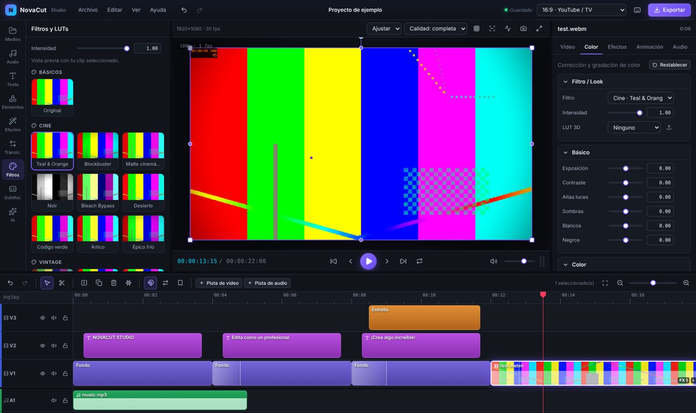
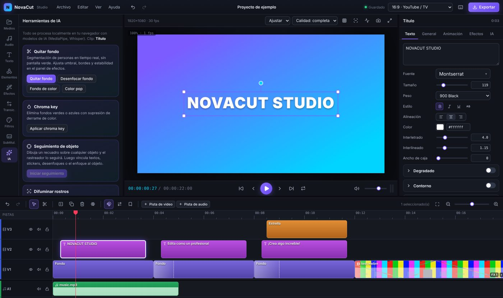
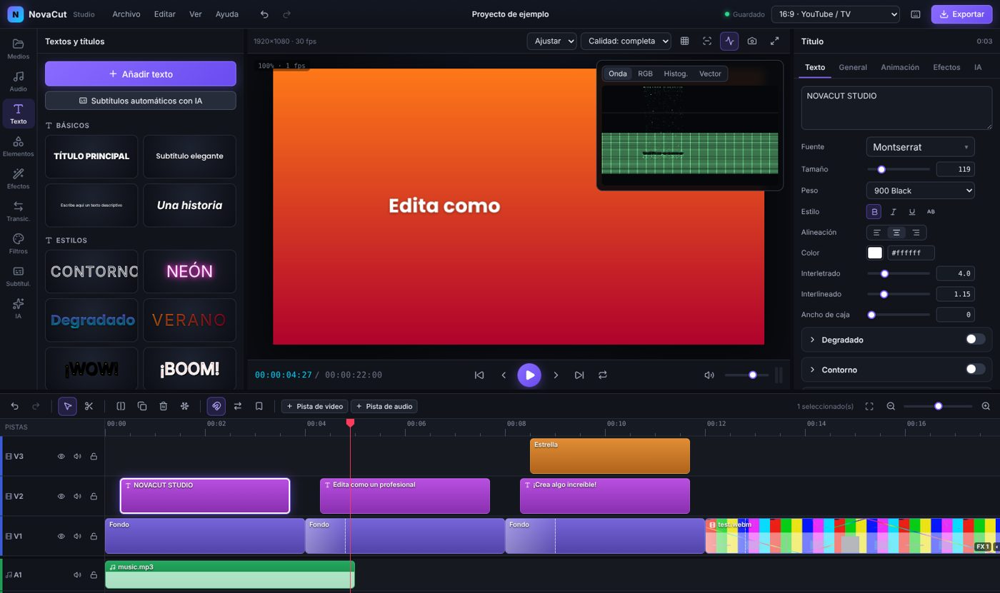
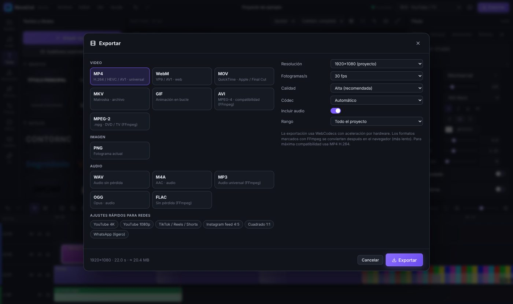
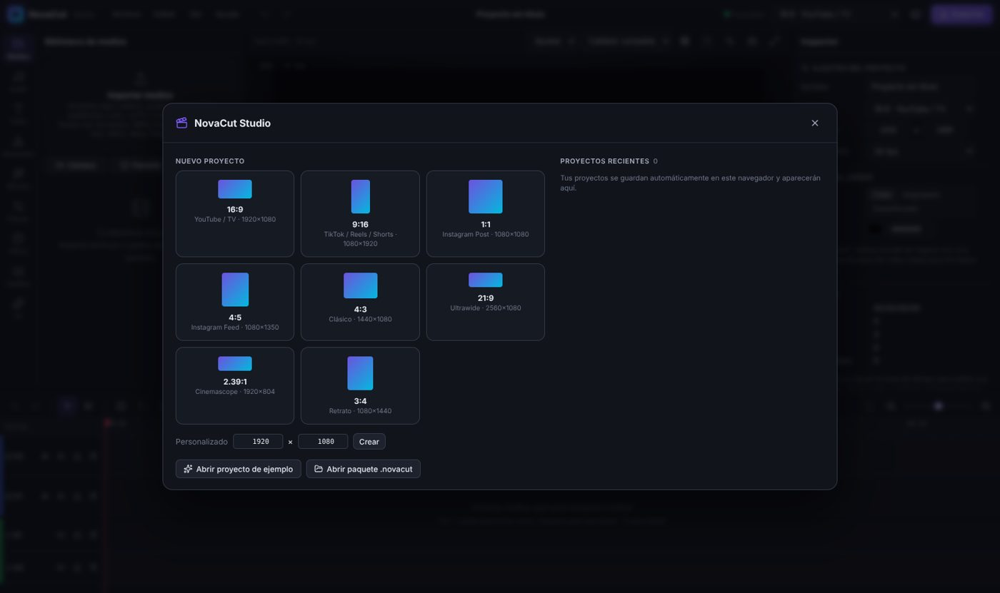
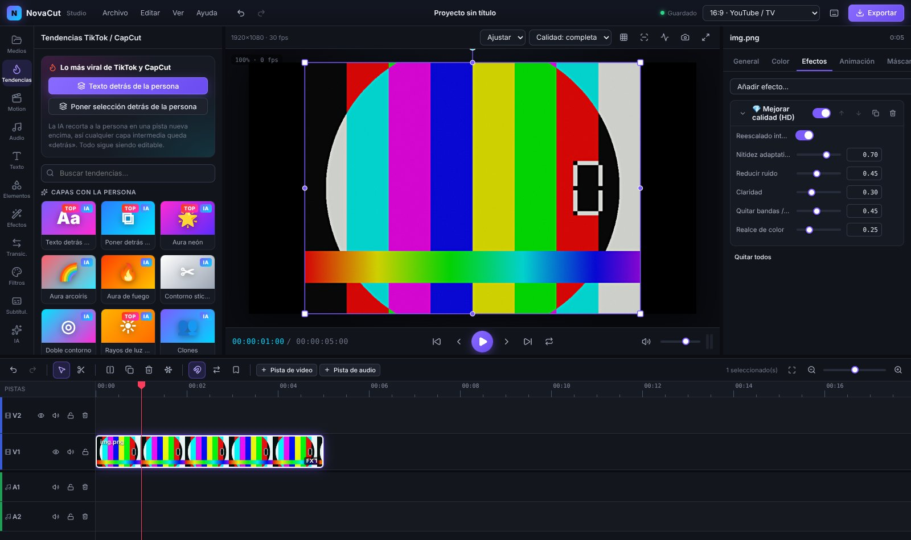
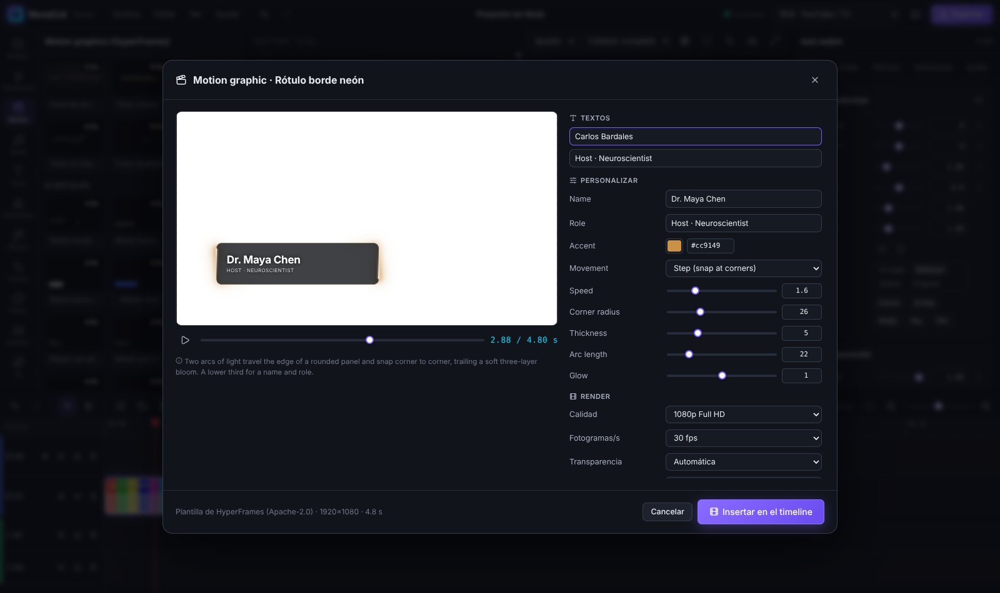
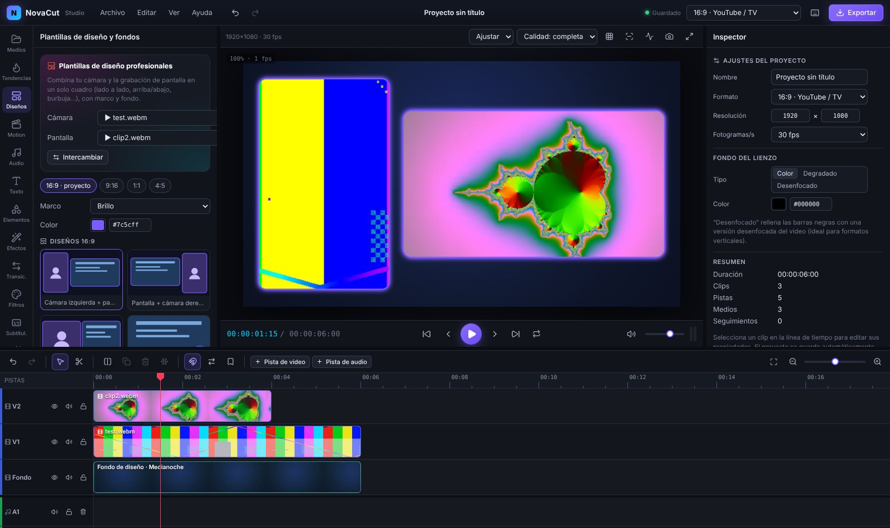
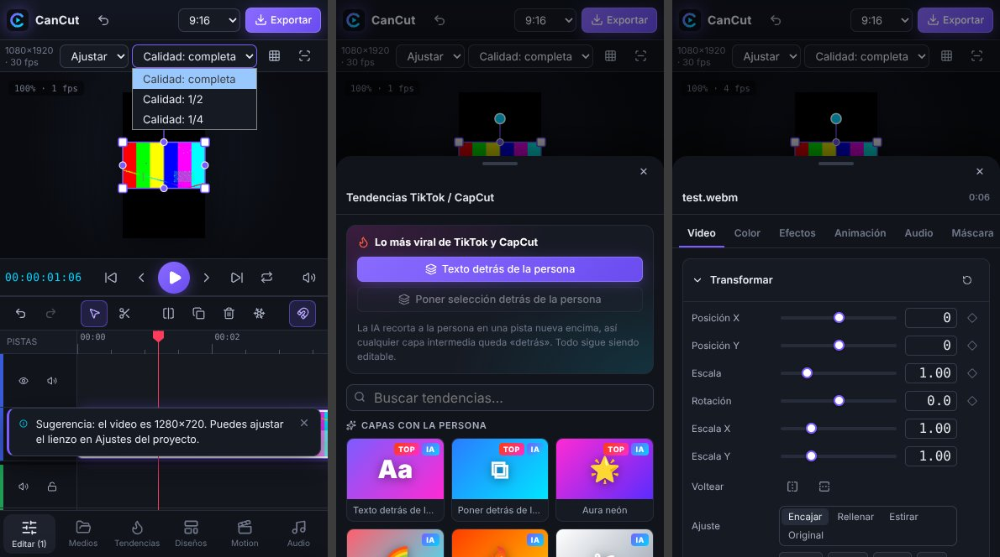

<div align="center">

# 🎬 CanCut

**Editor de video profesional que funciona 100 % en el navegador.**
Timeline multipista estilo Premiere/DaVinci, corrección de color con ruedas, curvas y LUTs, quitar fondo con IA, **efectos virales de TikTok/CapCut** (texto detrás de la persona, auras, clones, rayos…), **motion graphics de HyperFrames**, mejora de calidad, seguimiento de objetos, auto-reencuadre, estabilización, subtítulos automáticos con Whisper y exportación a todos los formatos **hasta 8K** — sin instalar nada y sin subir tus archivos a ningún servidor.



</div>

---

## ✨ Funciones

### Edición (nivel Premiere / DaVinci)
- **Timeline multipista** ilimitado: pistas de video y audio, bloquear, ocultar, silenciar, renombrar.
- Arrastrar, **recortar bordes**, **dividir** (cuchilla / `S`), duplicar, copiar/pegar, **ripple delete**, modo ripple, selección por recuadro.
- **Imán / snapping** a cortes, cabezal y marcadores · **marcadores** · zoom con `Ctrl + rueda`.
- **Deshacer / rehacer** ilimitado · atajos J/K/L, flechas, Inicio/Fin.
- **Velocidad** 0.1× – 8× con preservación de tono · **congelar fotograma** · **separar audio**.
- **Capas de ajuste** (aplican color y efectos a todo lo de abajo), sólidos y degradados.
- **Keyframes** en posición, escala, rotación, opacidad y volumen con curvas de aceleración.
- Visor con **gizmo** de transformación (mover, escalar, rotar, estirar), guías de centrado, **zonas seguras**, cuadrícula de tercios y pantalla completa.
- **Scopes** profesionales: forma de onda, desfile RGB, histograma y vectorscopio.
- Autoguardado en el navegador, **proyectos recientes** y proyectos `.cancut` portables (también abre `.novacut`) (proyecto + medios).

### Color
- Exposición, contraste, altas luces, sombras, blancos, negros, temperatura, matiz, saturación, intensidad, tono.
- **Ruedas de color Lift / Gamma / Gain** estilo DaVinci · **curvas RGB** · split toning · nitidez · viñeta.
- **58 filtros** cinematográficos y de TikTok (Teal & Orange, Blockbuster, Noir, Película 35 mm, Cyberpunk…) con intensidad y vista previa sobre tu clip.
- **LUTs 3D `.cube`** (Resolve, Premiere, etc.).
- 18 **modos de fusión** (multiplicar, trama, superponer, luz suave, color, luminosidad…).

### 47 efectos (GPU · WebGL2)
Desenfoque gaussiano, de movimiento y radial · tilt-shift · **censurar/difuminar zona** · **enfoque selectivo** · nitidez · bloom · grano · viñeta · barras de cine · chroma key · luma key · pixelar · aberración cromática · glitch · VHS · líneas CRT · semitono · posterizar · boceto · relieve · duotono · espejo · caleidoscopio · ondas · ojo de pez… Todos combinables, reordenables y con máscaras (rectángulo, elipse, lineal, corazón, estrella) con suavizado e inversión.

### 🔥 Tendencias TikTok / CapCut (panel «Tendencias»)
- **Texto detrás de la persona** (efecto profundidad) y **poner cualquier capa detrás de la persona** (texto, sticker, imagen, forma): la IA recorta al sujeto en una pista superior y todo sigue siendo editable.
- **Efectos con la persona (IA)**: aura neón, aura arcoíris, aura de fuego, contorno tipo sticker, doble contorno, **rayos de luz detrás**, **clones**, **estela fantasma** en el tiempo, clones en profundidad, modo retrato y color pop.
- **Ritmo y energía**: velocity beat, temblor de cámara, flash estroboscópico, zoom al ritmo, RGB shake, prisma.
- **Estética**: brillo de ensueño (Orton), destellos ✨, fugas de luz, Webcore Y2K, película antigua, **videocámara REC**, cine 2.39.
- **Partículas**: corazones, nieve, confeti, estrellas, bokeh, lluvia, brasas.
- **20 filtros TikTok**: Glow Up, Soft Light, Summer Tan, Clean Girl, Webcore, Portra 400, Golden Hour, Pink Aura, Moody Film…
- **9 transiciones virales**: whip pan (4 direcciones), zoom con desenfoque, sacudida, fuga de luz, giro + zoom, comprimir.

### 🎞 Motion graphics (panel «Motion», con [HyperFrames](https://github.com/heygen-com/hyperframes))
- **314 plantillas**: intros y títulos, rótulos (lower thirds), subtítulos animados, efectos de texto, 43 transiciones, demos de producto con cursor, redes sociales, overlays, fondos animados, código, mapas, carruseles, gráficos de datos y personajes.
- **Todo editable**: textos (también los animados por script), variables, **cualquier color de la plantilla**, imágenes, **velocidad**, mantener el final y **quitar el fondo** para usarla como overlay.
- Vista previa en vivo, calidad hasta 4K y 24–60 fps.
- Se renderizan en tu navegador y se insertan como capa de video **con transparencia** (WebM VP9 con alfa) sobre tu video, como intro, overlay o fondo.
- **Importa tus propias composiciones** HyperFrames (`.html` o proyecto `.zip`).

### 🧩 Plantillas de diseño (panel «Diseños»)
- **Cámara + pantalla compartida** en un solo cuadro: cámara a un lado y pantalla al otro, mitad y mitad, pantalla con burbuja (círculo) o ventana, cámara arriba / pantalla abajo (vertical), tarjeta sobre cámara… para **16:9, 9:16, 1:1 y 4:5**.
- Marcos con **esquinas redondeadas, borde, brillo neón o sombra**, y **fondos** (malla de color, aurora, cuadrícula de estudio, bokeh, puntos, degradados, video desenfocado…).
- **Estabilizador** (suave / normal / fuerte) a un clic.

### 💧 Zona de desenfoque (Elementos)
- Forma **movible, giratoria y redimensionable** (rectángulo, redondeado, elipse, corazón, estrella) que **desenfoca, pixela, esmerila u oscurece** todo lo que queda debajo. Con suavizado e inversión.

### 📱 Móvil y app instalable
- Interfaz adaptada a teléfonos y tabletas (visor + timeline + barra inferior con paneles deslizables).
- **Instalable como aplicación (PWA)** y con caché sin conexión de la app, plantillas y modelos de IA.

### 💎 Mejora de calidad
- Efecto **Mejorar calidad (HD)**: reescalado inteligente (bicúbico Catmull-Rom), nitidez adaptativa (CAS), reducción de ruido (bilateral), quitar bandas/bloques, claridad y realce de color + **corrección automática de color**.
- **Mejorar automáticamente al importar** (opcional) y **reescalar a 1080p / 2K / 4K / 8K** guardando una versión mejorada como medio nuevo.
- **Retoque de piel** con detección de tonos de piel.

### Inteligencia artificial (local, privada)
| Función | Tecnología |
|---|---|
| **Quitar fondo** sin pantalla verde (quitar, desenfocar, fondo de color, color pop) | MediaPipe Image Segmenter |
| **Seguimiento de objeto** (dibuja un recuadro → texto, sticker, desenfoque o enfoque lo siguen) | Rastreador ZNCC multiescala en Web Worker |
| **Difuminar rostros**: de frente, de perfil, de costado y de espaldas, con margen antes/después de cada aparición | MediaPipe Face Detector (también en mosaico) + Pose Landmarker (cabezas) + seguimiento e interpolación |
| **Auto-reencuadre / cámara inteligente** (16:9 → 9:16 siguiendo al sujeto) | Detección de rostros/personas + suavizado de trayectoria |
| **Estabilización** de video | Estimación de movimiento global por bloques |
| **Detección de escenas** (divide el clip en cada corte) | Diferencia de histogramas adaptativa |
| **Quitar silencios** (jump cuts automáticos) | Análisis RMS del audio |
| **Subtítulos automáticos** con marcas por palabra, karaoke y estilos virales | Whisper (Transformers.js · WebGPU/WASM) |

### Texto y diseño
- **+300 tipografías**: 277 Google Fonts por categorías con buscador, fuentes del sistema (Local Font Access) y **tus propias fuentes** (.ttf/.otf/.woff).
- Contorno, sombra, brillo neón, degradado, caja de fondo por bloque o por línea, interletrado, interlineado, ajuste de caja.
- **24 diseños** de texto (títulos, lower thirds, noticias, suscríbete, cómic, neón, glitch, retro…).
- **Animaciones** de entrada/salida (fade, pop, rebote, elástico, máquina de escribir, palabra por palabra, letras en cascada, glitch…) y **bucles** (pulso, flotar, temblor, Ken Burns, paneos…).
- **40 transiciones**: whip pan, zoom con desenfoque, sacudida, disolver, fundidos, barridos, deslizar, empujar, zoom, iris, corazón, reloj, giro, remolino, glitch, pixelado, destello, quemado de película…
- Formas vectoriales, **stickers/emojis**, fondos de color y degradado.
- **10 estilos de subtítulos**: clásico, caja negra, karaoke, viral amarillo, caja resaltada, una palabra, palabra a palabra, neón, minimal, burbuja.

### Audio
Formas de onda, volumen con keyframes, fundidos, paneo, ecualizador de 3 bandas con presets, **reducción de ruido**, **mejora de voz**, mezcla multipista, grabación de **voz en off**, efectos de sonido sintetizados (whoosh, pop, ding, impacto, riser…).

### Importación y exportación — todos los formatos
- **Importa**: MP4, MOV, MKV, WebM, AVI, WMV, FLV, MPG, TS, 3GP… · MP3, WAV, M4A, AAC, FLAC, OGG, OPUS… · PNG, JPG, WebP, GIF, SVG, AVIF… · SRT/VTT · LUT .cube · fuentes. Los formatos que el navegador no reproduce se **convierten automáticamente con FFmpeg.wasm**.
- **Graba** cámara, pantalla y micrófono directamente.
- **Exporta**: **MP4** (H.264 / HEVC / AV1), **WebM** (VP9 / AV1), **MOV**, **MKV**, **GIF**, **AVI**, **MPEG-2**, **PNG**, **WAV**, **M4A**, **MP3**, **OGG**, **FLAC**, subtítulos **SRT/VTT** — **240p hasta 8K UHD** (también 6K, 5K, 4K, 2K y 2×/3×/4×), 24–60 fps, calidad **Máster** o bitrate personalizado hasta 500 Mbps, **guardado directo en disco** para archivos enormes y presets para YouTube (8K/4K/1080p), TikTok/Reels/Shorts, Instagram y WhatsApp. Codificación acelerada por hardware con **WebCodecs** (8K con HEVC, AV1 o VP9 según tu equipo).

| | |
|---|---|
|  |  |
|  |  |
|  |  |
|  |  |

---

## 🚀 Publicarlo en GitHub Pages

1. Crea un repositorio **vacío** en <https://github.com/new> (por ejemplo `cancut`).
2. En Windows, haz doble clic en **`subir-a-github.bat`** y pega la URL del repositorio. O en CMD:

   ```cmd
   cd "C:\Users\TU_USUARIO\Documents\EDITOR DE VIDEO - CLAUDE"
   git init
   git add -A
   git commit -m "CanCut"
   git branch -M main
   git remote add origin https://github.com/TU_USUARIO/cancut.git
   git push -u origin main
   ```

3. En GitHub: **Settings → Pages → Build and deployment → Source: _GitHub Actions_**.
4. Espera ~2 minutos (pestaña **Actions**). Tu editor quedará en
   `https://TU_USUARIO.github.io/cancut/`

Cada `git push` vuelve a compilar y publicar automáticamente.

## 💻 Ejecutar en tu PC (opcional)

Requiere [Node.js 20+](https://nodejs.org). Doble clic en **`iniciar-local.bat`** o:

```cmd
npm install
npm run dev
```

Compilar para producción: `npm run build` (resultado en `dist/`).

## 🌐 Navegadores

| Navegador | Soporte |
|---|---|
| Chrome / Edge / Opera / Brave (escritorio) | ✅ Completo (recomendado) |
| Firefox | ✅ Edición y render · exportación según soporte de WebCodecs |
| Safari 17+ | ⚠️ Mayormente compatible |

Requisitos: WebGL2 (render), WebCodecs (exportación acelerada). La IA descarga sus modelos la primera vez (≈ 1–250 MB según la función) y luego quedan en caché.

## ⌨️ Atajos principales

`Espacio` reproducir · `J/K/L` retroceder/pausa/avanzar · `←/→` fotograma · `↑/↓` corte anterior/siguiente · `S` o `Ctrl+K` dividir · `Supr` eliminar · `Shift+Supr` eliminar y cerrar hueco · `Ctrl+Z / Ctrl+Shift+Z` deshacer/rehacer · `Ctrl+C/V/D` copiar/pegar/duplicar · `V` selección · `C` cuchilla · `T` texto · `M` marcador · `Ctrl+E` exportar · `Ctrl+S` guardar · `?` todos los atajos.

## 🏗️ Arquitectura

```
src/
├── core/        modelo de datos, keyframes, geometría, presets, tendencias TikTok, fuentes, medios, persistencia, acciones
├── render/      compositor WebGL2 (shaders GLSL, efectos, transiciones, fusión), texto y formas
├── engine/      reproducción en tiempo real, mezcla de audio, exportación (WebCodecs/Mediabunny), FFmpeg
├── ai/          MediaPipe (segmentación, rostros, objetos), rastreador en Worker, Whisper, análisis
├── motion/      integración HyperFrames: iframe + runtime oficial, rasterizado y codificación con alfa
├── store/       estado global (Zustand + Immer) con historial deshacer/rehacer
└── ui/          interfaz React: timeline, visor, inspector, paneles, diálogos
```

Detalles en [`docs/ARQUITECTURA.md`](docs/ARQUITECTURA.md).

## 🙌 Inspiración y referencias

CanCut se diseñó estudiando los mejores editores libres: **Kdenlive** y **Shotcut** (framework MLT: pistas, capas de ajuste, keyframes), **OpenShot**, **Olive** (pipeline de nodos y color en GPU), **Blender VSE**, **LosslessCut**, **Natron**, y editores web como **Omniclip** y **Diffusion Studio** (render con WebCodecs en el navegador). La interfaz toma lo mejor de Premiere Pro, DaVinci Resolve y CapCut.

## 📦 Software de terceros

| Proyecto | Licencia | Uso |
|---|---|---|
| [Mediabunny](https://github.com/Vanilagy/mediabunny) | MPL-2.0 | Lectura/escritura de MP4, WebM, MOV, MKV… |
| [MediaPipe Tasks](https://github.com/google-ai-edge/mediapipe) | Apache-2.0 | Segmentación, rostros y objetos |
| [Transformers.js](https://github.com/huggingface/transformers.js) | Apache-2.0 | Whisper (subtítulos) |
| [FFmpeg.wasm](https://github.com/ffmpegwasm/ffmpeg.wasm) | MIT (wrapper) · núcleo FFmpeg LGPL/GPL | Conversión de formatos (binario sin modificar desde npm `@ffmpeg/core`) |
| [HyperFrames](https://github.com/heygen-com/hyperframes) © HeyGen | Apache-2.0 | Plantillas de motion graphics y runtime (`public/hyperframes/`, ver `NOTICE.md`) |
| [GSAP](https://gsap.com) | Licencia estándar «no charge» | Animación de las plantillas HyperFrames |
| [modern-screenshot](https://github.com/qq15725/modern-screenshot) | MIT | Rasterizado DOM → canvas para renderizar motion graphics |
| three.js, d3, topojson-client, lottie-web, clipper-lib, world-atlas, us-atlas, es-atlas | MIT / ISC / BSL | Librerías usadas por algunas plantillas (servidas localmente) |
| React, Zustand, Immer, Lucide, fflate, gifenc | MIT/ISC | Interfaz, estado, iconos, ZIP, GIF |

## 📄 Licencia

[MIT](LICENSE) © 2026 Carlos Bardales
